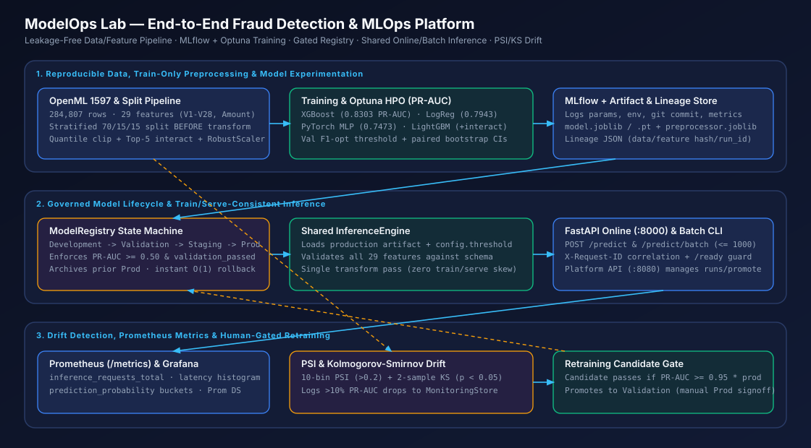
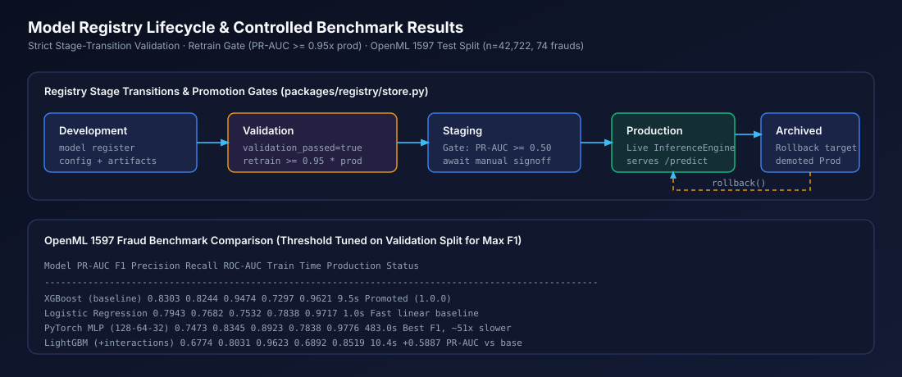

# ModelOps Lab

Production-oriented machine learning platform for tabular binary classification (fraud detection).

## Overview

ModelOps Lab implements an end-to-end ML engineering platform covering:

**data → features → experimentation → training → evaluation → model registry → deployment → inference → monitoring → drift detection → retraining → validation**

Built with Python 3.12+, PyTorch, LightGBM, XGBoost, MLflow, FastAPI, PostgreSQL, Prometheus, Grafana, and Optuna.

## Quick Start

```bash
# Install dependencies
uv sync --all-extras

# Copy environment config
cp .env.example .env

# Validate and prepare data
modelops data validate
modelops data prepare

# Train a model
modelops train configs/lightgbm/baseline.yaml

# Run all baseline experiments
python scripts/run_experiments.py

# Register and promote model
modelops model register <run_id> --version 1.0.0
modelops model promote 1.0.0 --stage validation
modelops model promote 1.0.0 --stage staging
modelops model promote 1.0.0 --stage production

# Start inference service
modelops serve

# Check drift
modelops drift check

# Create retraining candidate
modelops retrain
```

## Docker Compose

```bash
docker compose up -d
```

Services:
- **Inference API**: http://localhost:8000
- **Platform API**: http://localhost:8080
- **MLflow**: http://localhost:5000
- **Grafana**: http://localhost:3000 (admin/admin)
- **Prometheus**: http://localhost:9090

## CLI Commands

| Command | Description |
|---------|-------------|
| `modelops data validate` | Validate dataset |
| `modelops data prepare` | Run data pipeline |
| `modelops train <config>` | Train model |
| `modelops experiment run <config>` | Run experiment |
| `modelops experiment list` | List experiments |
| `modelops experiment compare EXP1 EXP2` | Compare experiments |
| `modelops experiment hpo <config>` | Hyperparameter optimization |
| `modelops model register <run_id>` | Register model |
| `modelops model promote <version>` | Promote model stage |
| `modelops model rollback` | Rollback production |
| `modelops serve` | Start inference service |
| `modelops drift check` | Check data drift |
| `modelops retrain` | Create retraining candidate |
| `modelops batch <input>` | Batch inference |

## Architecture




See [docs/architecture.md](docs/architecture.md) and [docs/interview-guide.md](docs/interview-guide.md) for detailed architecture documentation.

## Dataset

Uses **Credit Card Fraud Detection** from OpenML (dataset 1597) as an imbalanced binary classification problem. The dataset adapter interface supports plugging in additional datasets.

## Models

- Logistic Regression (baseline)
- LightGBM
- XGBoost
- PyTorch MLP

## Testing

```bash
uv run pytest tests/ -v
uv run ruff check packages apps tests
uv run mypy packages apps
```

## Documentation

- [Architecture](docs/architecture.md)
- [Architecture Interview Guide](docs/interview-guide.md)
- [Data Pipeline](docs/data.md)
- [Experiments](docs/experiments.md)
- [Model Lifecycle](docs/model-lifecycle.md)
- [Monitoring](docs/monitoring.md)
- [Drift Detection](docs/drift.md)
- [Deployment](docs/deployment.md)
- [Reproducibility](docs/reproducibility.md)

## License

MIT
