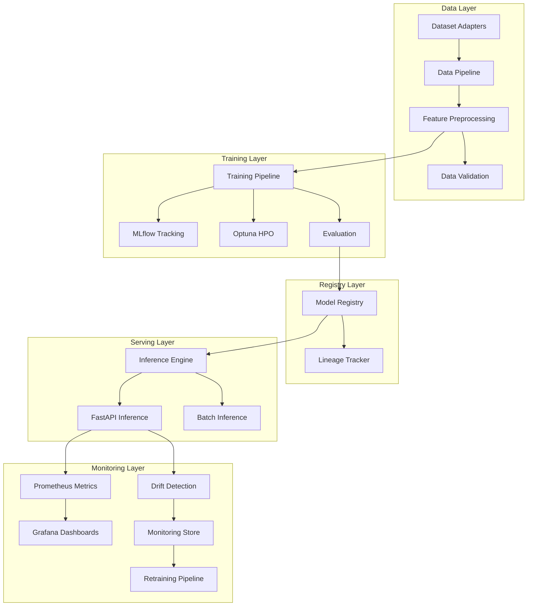

# Architecture

## System Overview

## Design Decisions

### Why Docker Compose over Kubernetes?

The first deployment uses Docker Compose for simplicity and local development parity. The architecture is containerized with clear service boundaries, making future Kubernetes migration straightforward without premature complexity.

### Why MLflow?

MLflow provides mature experiment tracking, artifact storage, and model registry capabilities. It integrates with PostgreSQL for production-grade metadata storage and supports reproducible experiment re-runs from configuration.

### Why a shared InferenceEngine?

Online (FastAPI) and batch inference share the same `InferenceEngine` to prevent logic duplication and ensure train/serve consistency. The preprocessor artifact is loaded alongside the model.

### Why file-based registry with promotion rules?

For a prototype platform, a file-based registry with explicit promotion rules demonstrates lifecycle management without requiring MLflow Model Registry setup. Production systems would migrate to MLflow Registry or a dedicated model store.

### Separation of Concerns

| Package | Responsibility |
|---------|---------------|
| `packages/data` | Ingestion, validation, splitting |
| `packages/features` | Preprocessing (fit on train only) |
| `packages/models` | Model implementations |
| `packages/training` | Training pipeline, HPO, retraining |
| `packages/evaluation` | Metrics, bootstrap CI, thresholds |
| `packages/registry` | Model lifecycle, lineage |
| `packages/drift` | PSI, KS drift detection |
| `packages/monitoring` | Events, performance tracking |
| `apps/inference` | FastAPI serving |
| `apps/api` | Platform management API |

## Data Leakage Prevention

1. **Preprocessor fit on training data only** — validation and test sets are transformed, never used for fitting
2. **Stratified splitting before preprocessing** — splits happen on raw data
3. **Target excluded from features** — explicit validation check
4. **No test data in HPO** — Optuna optimizes on validation set only

## API Architecture

Two services:
- **Inference API** (port 8000): Low-latency prediction endpoints
- **Platform API** (port 8080): Experiment management, model promotion, monitoring

This separation allows independent scaling of inference vs. management workloads.

## Limitations

- File-based registry (not distributed)
- No real-time feature store
- Single-node deployment
- Batch inference is synchronous
- No A/B testing framework (staging → production is manual promotion)
