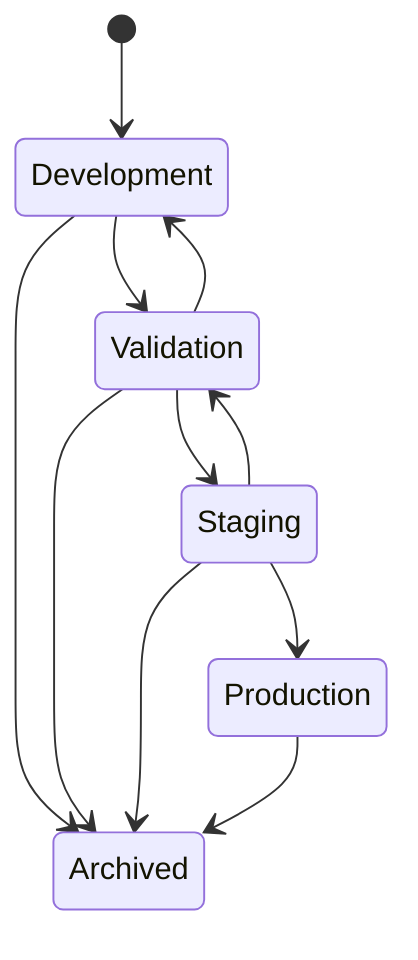
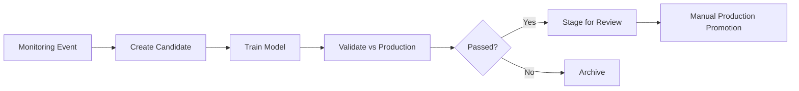

# Model Lifecycle

## Stages



## Promotion Rules

| Transition | Requirements |
|-----------|-------------|
| Development → Validation | Manual promotion |
| Validation → Staging | PR-AUC ≥ 0.5 |
| Staging → Production | `validation_passed = true`, PR-AUC ≥ 0.5 |
| Production → Archived | Automatic when new model promoted |

**Production promotion requires explicit validation.** A candidate cannot reach production without passing validation checks.

## Registration

```bash
modelops model register <mlflow_run_id> --version 1.0.0
```

Stores:
- Artifact path
- Metrics
- Training configuration
- Git commit
- Lineage ID

## Rollback

```bash
modelops model rollback
```

Demotes current production to archived, promotes most recent archived version to production.

## Retraining Workflow



Retraining does **not** automatically deploy. Human approval required for production replacement.

## Lineage

Every model traces back to:
- Dataset version
- Preprocessing version
- Experiment run ID
- Git commit
- Configuration file

Query: `GET /lineage/{record_id}`
